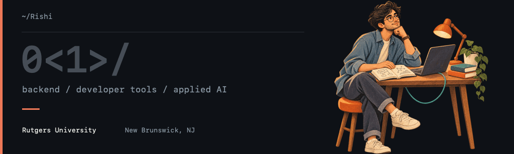
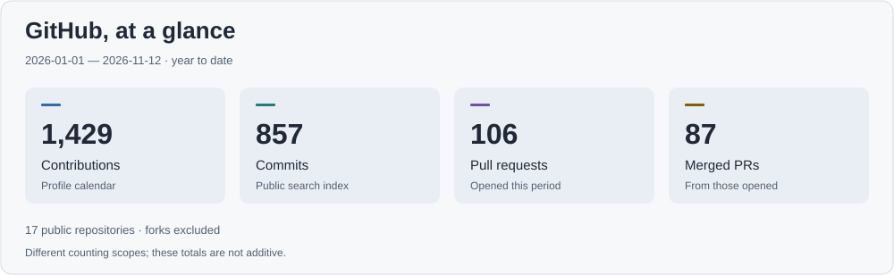
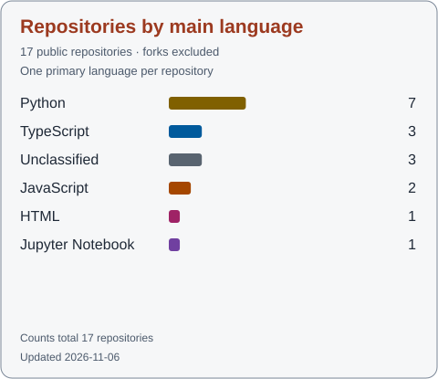
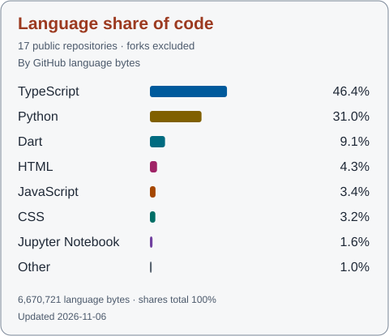

<picture>
  <source media="(prefers-reduced-motion: reduce)" srcset="assets/rishi-header-still.png" />
  
</picture>

# Hey, I'm Rishi.

I'm a computer science master's student at Rutgers University in New Brunswick, graduating in May 2027. My interests sit around backend engineering, systems, and developer tools.

I like understanding what happens behind an interface. Following a request through a service, figuring out where the data goes, or tracking down an unexpected failure can keep me occupied for a while. I care about clear interfaces and code that someone else can pick up without having to guess what I meant.

Lately, I've been exploring the engineering around AI. I'm interested in how coding agents find useful context, how voice interfaces hold a conversation, and how to make those experiences reliable. There's a lot to learn in the space between a model responding and a person actually finding it useful.

I enjoy talking through a design and questioning whether it needs to be as complicated as it first appears. Building things is part of that, but so is reading, asking questions, and getting a better understanding of the tools I already use.

[Selected work](#selected-work) · [Tech stack](#tech-stack) · [GitHub activity](#github-activity) · [Get in touch](#get-in-touch)

## Selected work

<table width="100%">
<tr>
<td width="50%" valign="top">

<strong><a href="https://composur.tech">Composur ↗</a></strong>

A place to rehearse software interviews out loud. An AI interviewer asks follow-up questions, then gives feedback tied to what the candidate actually said.

<strong>8 interview types</strong> · recordings, transcripts, and scored feedback

<code>Go</code> <code>Next.js</code> <code>PostgreSQL</code> <code>pgvector</code> <code>AWS S3</code>

</td>
<td width="50%" valign="top">

<strong><a href="https://github.com/RishiiShah/CseGraph">CseGraph ↗</a></strong>

A local map that helps coding assistants find the right code for a task. It returns relevant functions and their connections, keeping the context focused.

<strong>Local index</strong> · task-specific context through CLI and MCP

<code>Python</code> <code>SQLite</code> <code>Tree-sitter</code> <code>MCP</code>

</td>
</tr>
<tr>
<td width="50%" valign="top">

<strong><a href="https://github.com/RishiiShah/Traffic">Traffic Violation Detection ↗</a></strong>

Turns traffic video into a complete ticketing workflow: detect a violation, read the number plate, save the supporting evidence, and deliver a digital ticket by SMS.

<strong>Detection to digital ticket</strong> · OCR, evidence storage, and SMS delivery

<code>Python</code> <code>YOLO</code> <code>OpenCV</code> <code>AWS S3</code> <code>Twilio</code>

</td>
<td width="50%" valign="top">

<strong><a href="https://github.com/RishiiShah/Jarvis">JARVIS ↗</a></strong>

A voice assistant that turns spoken requests into answers and home actions. Commands reach a Raspberry Pi through Azure IoT Hub to control connected devices.

<strong>Voice commands</strong> · answers, reminders, and home automation

<code>Python</code> <code>Django</code> <code>Groq</code> <code>Azure IoT Hub</code>

</td>
</tr>
</table>

## Tech stack

<table width="100%">
<tr>
<td width="50%" valign="top">
<h3>Languages</h3>
<picture>
  <source media="(max-width: 600px) and (prefers-color-scheme: dark)" srcset="assets/tech/languages-dark.svg" />
  <source media="(max-width: 600px)" srcset="assets/tech/languages-light.svg" />
  <source media="(prefers-color-scheme: dark)" srcset="assets/tech/languages-wide-dark.svg" />
  
</picture>

Python · Java · C++ · C · TypeScript · JavaScript · SQL · Go

</td>
<td width="50%" valign="top">
<h3>Backend &amp; APIs</h3>
<picture>
  <source media="(max-width: 600px) and (prefers-color-scheme: dark)" srcset="assets/tech/backend-dark.svg" />
  <source media="(max-width: 600px)" srcset="assets/tech/backend-light.svg" />
  <source media="(prefers-color-scheme: dark)" srcset="assets/tech/backend-wide-dark.svg" />
  
</picture>

Django · Django REST Framework · FastAPI · Express.js · REST APIs · Pydantic · Celery · JWT · Clerk (Google OAuth) · RBAC

</td>
</tr>
<tr>
<td width="50%" valign="top">
<h3>Frontend</h3>
<picture>
  <source media="(prefers-color-scheme: dark)" srcset="assets/tech/frontend-dark.svg" />
  
</picture>

React · Next.js · Tailwind CSS

</td>
<td width="50%" valign="top">
<h3>Data &amp; storage</h3>
<picture>
  <source media="(max-width: 600px) and (prefers-color-scheme: dark)" srcset="assets/tech/data-dark.svg" />
  <source media="(max-width: 600px)" srcset="assets/tech/data-light.svg" />
  <source media="(prefers-color-scheme: dark)" srcset="assets/tech/data-wide-dark.svg" />
  
</picture>

PostgreSQL · pgvector · MySQL · SQLite · MongoDB · Redis · Supabase

</td>
</tr>
<tr>
<td width="50%" valign="top">
<h3>AI &amp; machine learning</h3>
<picture>
  <source media="(max-width: 600px) and (prefers-color-scheme: dark)" srcset="assets/tech/ml-dark.svg" />
  <source media="(max-width: 600px)" srcset="assets/tech/ml-light.svg" />
  <source media="(prefers-color-scheme: dark)" srcset="assets/tech/ml-wide-dark.svg" />
  
</picture>

PyTorch · TensorFlow · Keras · Scikit-learn · NumPy · Pandas · Transformers.js · RAG · Embeddings · LLM APIs (Groq, Gemini)

</td>
<td width="50%" valign="top">
<h3>Computer vision</h3>
<picture>
  <source media="(prefers-color-scheme: dark)" srcset="assets/tech/vision-dark.svg" />
  
</picture>

OpenCV · Ultralytics YOLO · Roboflow · ByteTrack · Supervision

</td>
</tr>
<tr>
<td width="50%" valign="top">
<h3>Cloud &amp; infrastructure</h3>
<picture>
  <source media="(max-width: 600px) and (prefers-color-scheme: dark)" srcset="assets/tech/cloud-dark.svg" />
  <source media="(max-width: 600px)" srcset="assets/tech/cloud-light.svg" />
  <source media="(prefers-color-scheme: dark)" srcset="assets/tech/cloud-wide-dark.svg" />
  
</picture>

AWS (EC2, S3, ECS Fargate, SES) · GCP · Azure · Docker · Linux · Vercel · Render

</td>
<td width="50%" valign="top">
<h3>Developer tools &amp; testing</h3>
<picture>
  <source media="(max-width: 600px) and (prefers-color-scheme: dark)" srcset="assets/tech/tools-dark.svg" />
  <source media="(max-width: 600px)" srcset="assets/tech/tools-light.svg" />
  <source media="(prefers-color-scheme: dark)" srcset="assets/tech/tools-wide-dark.svg" />
  
</picture>

GitHub Actions · CI/CD · Jenkins · Git · Tree-sitter · MCP · Pytest · Vitest · Playwright · Postman

</td>
</tr>
</table>

## GitHub activity

<picture>
  <source media="(max-width: 600px) and (prefers-color-scheme: dark)" srcset="assets/stats/activity-compact-dark.svg" />
  <source media="(max-width: 600px)" srcset="assets/stats/activity-compact-light.svg" />
  <source media="(prefers-color-scheme: dark)" srcset="assets/stats/activity-dark.svg" />
  
</picture>

<picture>
  <source media="(prefers-color-scheme: dark)" srcset="assets/stats/languages-repos-dark.svg" />
  
</picture>
<picture>
  <source media="(prefers-color-scheme: dark)" srcset="assets/stats/languages-bytes-dark.svg" />
  
</picture>

Profile activity is year to date. Both language charts use the same public repositories, excluding forks: one counts repositories by their main language, while the other measures the share of code bytes.

## Get in touch

I'm happy to talk about backend systems, developer tools, or an idea you're still figuring out.

- Website: [https://rishabhshah.me](https://rishabhshah.me)
- LinkedIn: [https://linkedin.com/in/rishabh-shah1](https://linkedin.com/in/rishabh-shah1)
- GitHub: [https://github.com/RishiiShah](https://github.com/RishiiShah)

Data: <a href="https://github.com/RishiiShah">GitHub profile</a> and <a href="https://docs.github.com/en/rest/repos/repos">GitHub REST API</a>. Icons: <a href="https://github.com/devicons/devicon">Devicon</a> and <a href="https://github.com/simple-icons/simple-icons">Simple Icons</a>.
